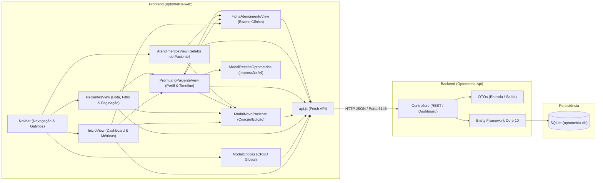
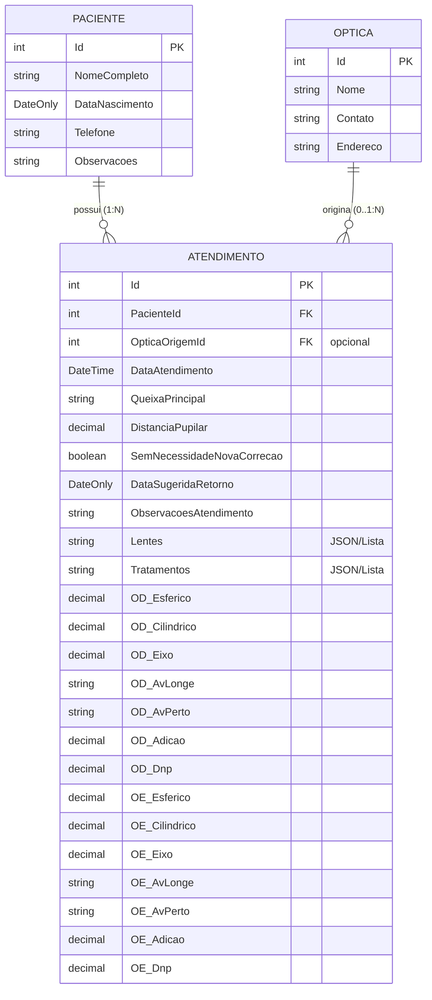

# Referência Técnica

Documentação da arquitetura do sistema, modelagem de dados e padrões de comunicação entre backend e frontend. Serve como guia para desenvolvedores entenderem o fluxo de dados e a organização interna do código.

---

## 1. Visão Geral da Arquitetura

O sistema adota uma arquitetura em duas camadas desacopladas (Frontend SPA e Backend Web API), comunicando-se via requisições HTTP REST em formato JSON:

* **Frontend:** Single Page Application (SPA) desenvolvida com **React 19**, empacotada com **Vite 8**, biblioteca de ícones **Lucide React** (`lucide-react`) e executando localmente na porta `5173`.
* **Backend:** API REST desenvolvida em **ASP.NET Core (.NET 10)**, executando na porta `5145`.
* **Banco de Dados:** **SQLite**, persistido no arquivo local `Optometria.Api/optometria.db`.

---

## 2. Modelo de Dados Relacional (ER)

O banco de dados é estruturado em torno do fluxo clínico do paciente. As medições ópticas de Olho Direito e Olho Esquerdo são modeladas como tipos embutidos (*Owned Types*) dentro da tabela de atendimentos.

### Particularidades do Mapeamento (EF Core)

1. **Atendimento → Paciente:** Chave estrangeira `PacienteId` obrigatória. Configurado com `OnDelete(DeleteBehavior.Restrict)` para impedir que a exclusão acidental de um paciente apague atendimentos históricos sem confirmação.
2. **Atendimento → Ótica:** Chave estrangeira `OpticaOrigemId` anulável (`int?`). Quando nulo, o atendimento é tratado como particular.
3. **Tipos Embutidos (Owned Types):** A classe `RefratometriaOlho` não possui tabela própria. No `OptometriaDbContext`, as propriedades `OlhoDireito` e `OlhoEsquerdo` são configuradas via `.OwnsOne()`, gravando as colunas de medições diretamente na tabela `Atendimentos`.

---

## 3. Padrão de Camadas do Backend

O backend está organizado em pastas por responsabilidade dentro do projeto `Optometria.Api`:

* **`Models/`:** Representam as entidades de domínio e as tabelas do banco de dados (`Paciente`, `Atendimento`, `Optica`, `RefratometriaOlho`).
* **`DTOs/` (Data Transfer Objects):** Objetos de transferência para entrada e saída da API. Evitam expor as entidades de banco diretamente na rede e protegem contra envio de campos indevidos:
  * Criação: `CriarPacienteDto`, `CriarAtendimentoDto`, `CriarOpticaDto`.
  * Leitura: `PacienteDto` (com data da `UltimaConsulta` calculada pelo backend), `AtendimentoDto`, `OpticaDto`, `RefratometriaOlhoDto`, `DashboardDto`.
* **`Controllers/`:** Controladores que expõem as rotas REST:
  * `PacientesController`: Gerenciamento e listagem de pacientes com busca por nome/telefone e cálculo de última consulta.
  * `OpticasController`: CRUD de óticas parceiras com filtro por nome.
  * `AtendimentosController`: Registro de consultas clínicas e consulta de histórico por paciente.
  * `DashboardController` (`GET /api/dashboard`): Agrega contadores consolidados (total de pacientes, total de óticas, consultas do mês e consultas do dia) e os 5 atendimentos mais recentes. *(Nota: a exibição de lista de próximos retornos clínicos sugeridos foi descontinuada do dashboard para manter o painel inicial objetivo e focado em métricas operacionais e atendimentos recentes).*
  * *Validação de Integridade:* Tanto em `OpticasController.Excluir(id)` quanto em `PacientesController.Excluir(id)`, o sistema verifica preventivamente se existem atendimentos vinculados antes de remover a entidade (`AnyAsync`); havendo registros associados, a exclusão é rejeitada com status `400 BadRequest` e mensagem amigável, garantindo a integridade dos dados históricos.
* **`Data/`:** Contém o `OptometriaDbContext`, que herda do Entity Framework Core e mapeia os `DbSet<>` das entidades, configurando relacionamentos e restrições.
* **`Migrations/`:** Histórico de versionamento do esquema do banco de dados gerado pela ferramenta `dotnet-ef`.

---

## 4. Estrutura de Componentes do Frontend

A aplicação React em `optometria-web/` adota componentes modulares com estilização em CSS puro por componente:

* **[`src/components/Navbar.jsx`](file:///c:/Users/71588959473/Documents/GitHub/sistema-gestao-optometrica/optometria-web/src/components/Navbar.jsx):**
  * Barra de navegação superior fixa com duas faixas.
  * Faixa superior: identidade visual (*OptoSystem*), atalho direto para acionar o modal global de óticas parceiras e identificação do profissional (avatar e nome).
  * Faixa inferior: abas de navegação principal (*Início*, *Pacientes*, *Atendimentos*) e exibição dinâmica da data atual formatada por extenso no padrão brasileiro (`Intl.DateTimeFormat`).
* **[`src/components/InicioView.jsx`](file:///c:/Users/71588959473/Documents/GitHub/sistema-gestao-optometrica/optometria-web/src/components/InicioView.jsx):**
  * Painel inicial (Dashboard) consumindo `dashboardService.obterResumo()`.
  * **Métricas em tempo real:** 4 cartões com indicadores de total de pacientes, atendimentos no mês, atendimentos no dia e total de óticas parceiras.
  * **Atalhos rápidos:** Botões de ação para abrir diretamente o fluxo de nova consulta e cadastro de novo paciente.
  * **Painel de Atendimentos Recentes:** Exibição dos últimos atendimentos realizados com dados do paciente, ótica de origem e atalho "Ver" para navegação direta ao prontuário. *(O painel de próximos retornos clínicos sugeridos foi descontinuado)*.
* **[`src/components/ModalOpticas.jsx`](file:///c:/Users/71588959473/Documents/GitHub/sistema-gestao-optometrica/optometria-web/src/components/ModalOpticas.jsx):**
  * Modal global exibido em sobreposição (*overlay*), permitindo acesso ao CRUD completo de óticas a qualquer momento sem trocar de rota ou perder dados preenchidos em atendimentos.
  * **Layout em duas colunas:**
    * *Coluna da esquerda:* Formulário reativo para cadastro de nova ótica ou edição de registro existente, com zona de exclusão protegida por confirmação em duas etapas ("Desativar parceria").
    * *Coluna da direita:* Listagem com indicador de status (*Ativa* / *Em edição*), contador total de parceiras e campo de busca rápida em tempo real por nome ou telefone/contato.
  * **Feedback visual:** Sistema de alertas interno (*banner* de sucesso ou erro) com temporizador para auto-ocultamento após 8 segundos.
* **[`src/components/ModalNovoPaciente.jsx`](file:///c:/Users/71588959473/Documents/GitHub/sistema-gestao-optometrica/optometria-web/src/components/ModalNovoPaciente.jsx):**
  * Modal compartilhado para **cadastro** e **edição** de pacientes.
  * Aplica máscara em tempo real para telefone/WhatsApp (`(00) 00000-0000`), validação de campos obrigatórios (nome, data de nascimento e contato) e área para anotações clínicas livres.
  * Feedback contextual de erro ou sucesso e integração com gatilho de recarga no componente pai (`onPacienteSalvo`).
* **[`src/components/PacientesView.jsx`](file:///c:/Users/71588959473/Documents/GitHub/sistema-gestao-optometrica/optometria-web/src/components/PacientesView.jsx):**
  * Visão principal da aba de Pacientes, exibindo a tabela com todos os registros ativos.
  * **Filtros e Controles:** Barra de busca mista (consulta via backend por nome e refinamento instantâneo por telefone), seletor de ordenação (*Nome A-Z*, *Nome Z-A*, *Mais recentes*) e paginação cliente com 10 registros por página.
  * Transição de visão: ação "Ver prontuário" que passa o registro selecionado para exibição detalhada.
* **[`src/components/ProntuarioPacienteView.jsx`](file:///c:/Users/71588959473/Documents/GitHub/sistema-gestao-optometrica/optometria-web/src/components/ProntuarioPacienteView.jsx):**
  * Visão individual do prontuário com layout em duas colunas:
    * *Coluna esquerda (Ficha Cadastral):* Avatar com iniciais, código formatado de identificação clínica (`PAC-XXXXX`), dados de contato, data de nascimento com **cálculo automático de idade em anos**, observações permanentes e botões para "Editar cadastro" (reabre o modal preenchido) e "Excluir paciente" (com caixa de dupla confirmação antes do disparo para o backend).
    * *Coluna direita (Linha do Tempo Clínica):* Painel que consome `atendimentoService.obterHistoricoPorPaciente(id)` e renderiza uma linha do tempo cronológica com todas as consultas. Cada item da timeline apresenta os dados de refração comparativos (OD/OE: Esférico, Cilíndrico, Eixo, AV, Adição e DNP), indicação de ótica de origem, queixa principal, recomendações de lentes/tratamentos, data sugerida de retorno e botão "Imprimir receita" que abre a pré-visualização.
  * Botão de retorno rápido para a lista e atalho "Nova Consulta" que direciona para a ficha clínica.
* **[`src/components/AtendimentosView.jsx`](file:///c:/Users/71588959473/Documents/GitHub/sistema-gestao-optometrica/optometria-web/src/components/AtendimentosView.jsx):**
  * Ponto de entrada da aba de Atendimentos quando nenhum paciente está em consulta ativa.
  * Seletor interativo com barra de busca inteligente (filtra por nome ou dígitos de telefone instantaneamente) para abrir a ficha clínica de um paciente cadastrado ou acionar o modal para registrar um novo paciente.
* **[`src/components/FichaAtendimentoView.jsx`](file:///c:/Users/71588959473/Documents/GitHub/sistema-gestao-optometrica/optometria-web/src/components/FichaAtendimentoView.jsx):**
  * Formulário clínico para registro de consultas optométricas organizado em duas colunas:
    * *Coluna da esquerda:* Dados de identificação do paciente, data do exame (sugerindo a data atual como padrão) e seleção da ótica parceira de origem (dropdown alimentado pela API de óticas ou opção "Particular").
    * *Coluna da direita:*
      * Queixa principal e anamnese.
      * Tabela refrativa completa com inputs numéricos para Esférico, Cilíndrico, Eixo, AV Longe, AV Perto, Adição e DNP monocular para Olho Direito (OD) e Olho Esquerdo (OE).
      * Medição de Distância Pupilar total (DP) e checkbox de "Sem necessidade de nova correção".
      * Conduta óptica com seleção múltipla por chips (*badges*) para tipos de lentes (Visão Simples, Multifocal, etc.) e tratamentos (Antirreflexo, Blue Cut, etc.).
      * Data sugerida de retorno com **cálculo automático para 1 ano à frente** a partir da data de atendimento selecionada.
      * Campo livre para observações e conduta clínica.
  * Ao salvar com sucesso, redireciona automaticamente o usuário para a tela de prontuário do paciente exibindo feedback visual de confirmação.
* **[`src/components/ModalReceitaOptometrica.jsx`](file:///c:/Users/71588959473/Documents/GitHub/sistema-gestao-optometrica/optometria-web/src/components/ModalReceitaOptometrica.jsx):**
  * Modal de pré-visualização e impressão da prescrição médica optométrica.
  * Formata visualmente os graus refrativos com sinal (+/-) e duas casas decimais, graus de eixo (`°`), lentes, tratamentos, validade/retorno e dados do profissional.
  * **Mecanismo de Impressão via Iframe Isolado:** Em vez de imprimir a janela principal (o que poluiria a impressão com menus, botões e barras de rolagem), o componente cria um `<iframe>` temporário injetando exclusivamente a folha de receita com estilos `@page { size: A4 portrait; margin: 1.2cm 1.5cm; }`. Isso garante uma impressão limpa, profissional e em página única física sem folhas em branco.
* **Orquestração no [`src/App.jsx`](file:///c:/Users/71588959473/Documents/GitHub/sistema-gestao-optometrica/optometria-web/src/App.jsx):**
  * Máquina de estados centralizada que gerencia a aba ativa (`inicio`, `pacientes`, `atendimentos`), modais globais (`ModalOpticas`, `ModalNovoPaciente`, `ModalReceitaOptometrica`), e a navegação contextual (ex: de Atendimentos para Prontuário pós-salvamento, ou de Prontuário para Nova Consulta com o paciente pré-selecionado).

---

## 5. Integração Frontend-Backend

A comunicação do frontend React com a API é centralizada no módulo de serviço [optometria-web/src/services/api.js](file:///c:/Users/71588959473/Documents/GitHub/sistema-gestao-optometrica/optometria-web/src/services/api.js):

* **URL Base:** `http://localhost:5145/api`.
* **Políticas de CORS:** Configurada no `Program.cs` do backend para aceitar requisições de `http://localhost:5173`.
* **Tratamento de Erros:** A função auxiliar `handleResponse` intercepta retornos diferentes de sucesso (`2xx`), captura mensagens amigáveis enviadas pela API no formato `{ mensagem: "..." }` e propaga erros tratáveis pela interface.

---

## 6. Testes e Exploração da API

Com o backend em execução (`dotnet run --launch-profile http`), a especificação OpenAPI interativa pode ser acessada em:

* **Swagger UI:** `http://localhost:5145/swagger`

O Swagger permite testar envios de payloads, simular cadastros e consultar respostas diretamente pelo navegador sem necessidade de ferramentas externas como Postman ou Insomnia.
