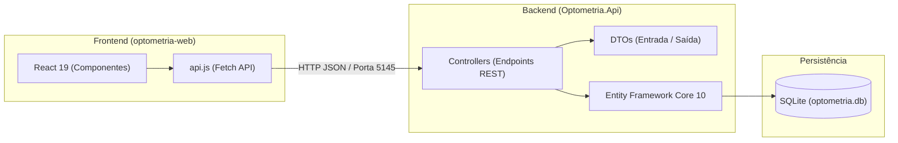
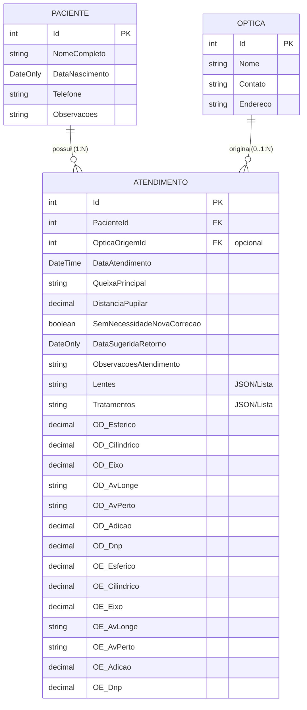

# Referência Técnica

Documentação da arquitetura do sistema, modelagem de dados e padrões de comunicação entre backend e frontend. Serve como guia para desenvolvedores entenderem o fluxo de dados e a organização interna do código.

---

## 1. Visão Geral da Arquitetura

O sistema adota uma arquitetura em duas camadas desacopladas (Frontend SPA e Backend Web API), comunicando-se via requisições HTTP REST em formato JSON:

* **Frontend:** Single Page Application (SPA) desenvolvida com **React 19** e empacotada com **Vite 8**, executando localmente na porta `5173`.
* **Backend:** API REST desenvolvida em **ASP.NET Core (.NET 10)**, executando na porta `5145`.
* **Banco de Dados:** **SQLite**, persistido no arquivo local `Optometria.Api/optometria.db`.

---

## 2. Modelo de Dados Relacional (ER)

O banco de dados é estruturado em torno do fluxo clínico do paciente. As medições ópticas de Olho Direito e Olho Esquerdo são modeladas como tipos embutidos (*Owned Types*) dentro da tabela de atendimentos.

### Particularidades do Mapeamento (EF Core)

1. **Atendimento → Paciente:** Chave estrangeira `PacienteId` obrigatória. Configurado com `OnDelete(DeleteBehavior.Restrict)` para impedir que a exclusão acidental de um paciente apague atendimentos históricos sem confirmação.
2. **Atendimento → Ótica:** Chave estrangeira `OpticaOrigemId` anulável (`int?`). Quando nulo, o atendimento é tratado como particular.
3. **Tipos Embutidos (Owned Types):** A classe `RefratometriaOlho` não possui tabela própria. No `OptometriaDbContext`, as propriedades `OlhoDireito` e `OlhoEsquerdo` são configuradas via `.OwnsOne()`, gravando as colunas de medições diretamente na tabela `Atendimentos`.

---

## 3. Padrão de Camadas do Backend

O backend está organizado em pastas por responsabilidade dentro do projeto `Optometria.Api`:

* **`Models/`:** Representam as entidades de domínio e as tabelas do banco de dados (`Paciente`, `Atendimento`, `Optica`, `RefratometriaOlho`).
* **`DTOs/` (Data Transfer Objects):** Objetos de transferência para entrada e saída da API. Evitam expor as entidades de banco diretamente na rede e protegem contra envio de campos indevidos:
  * Criação: `CriarPacienteDto`, `CriarAtendimentoDto`, `CriarOpticaDto`.
  * Leitura: `PacienteDto`, `AtendimentoDto`, `OpticaDto`, `RefratometriaOlhoDto`.
* **`Controllers/`:** Controladores que expõem as rotas REST (`PacientesController`, `AtendimentosController`, `OpticasController`). Responsáveis por validar os dados recebidos, orquestrar a consulta ou salvamento e retornar o código HTTP adequado (ex.: `200 OK`, `201 Created`, `400 BadRequest`, `404 NotFound`, `204 NoContent`).
* **`Data/`:** Contém o `OptometriaDbContext`, que herda do Entity Framework Core e mapeia os `DbSet<>` das entidades, configurando relacionamentos e restrições.
* **`Migrations/`:** Histórico de versionamento do esquema do banco de dados gerado pela ferramenta `dotnet-ef`.

---

## 4. Integração Frontend-Backend

A comunicação do frontend React com a API é centralizada no módulo de serviço [optometria-web/src/services/api.js](file:///c:/Users/Usuário/Documents/GitHub/sistema-gestao-optometrica/optometria-web/src/services/api.js):

* **URL Base:** `http://localhost:5145/api`.
* **Políticas de CORS:** Configurada no `Program.cs` do backend para aceitar requisições de `http://localhost:5173`.
* **Tratamento de Erros:** A função auxiliar `handleResponse` intercepta retornos diferentes de sucesso (`2xx`), captura mensagens amigáveis enviadas pela API no formato `{ mensagem: "..." }` e propaga erros tratáveis pela interface.

---

## 5. Testes e Exploração da API

Com o backend em execução (`dotnet run --launch-profile http`), a especificação OpenAPI interativa pode ser acessada em:

* **Swagger UI:** `http://localhost:5145/swagger`

O Swagger permite testar envios de payloads, simular cadastros e consultar respostas diretamente pelo navegador sem necessidade de ferramentas externas como Postman ou Insomnia.
