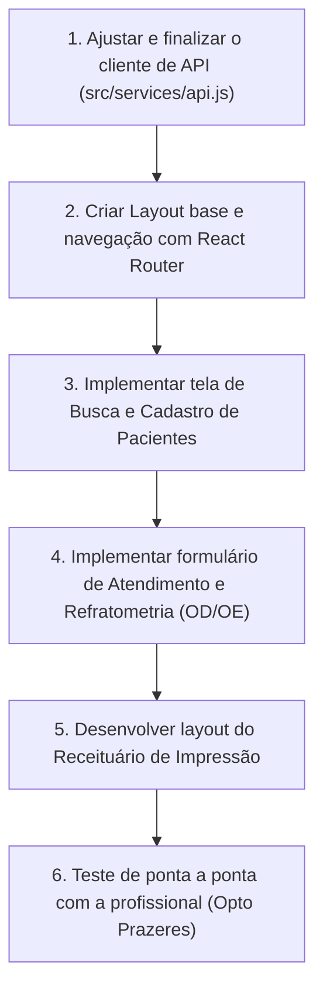

# Sistema de Gestão Optométrica — Status e Roadmap de Desenvolvimento

> **Data de Atualização:** 29/10/2026  
> **Status Geral:** Backend do MVP em estágio avançado (~85%); Frontend inicializado (~15%).

---

## 1. Matriz de Progresso dos Requisitos (MVP)

| ID | Requisito Funcional | Backend | Frontend | Status |
|---|---|:---:|:---:|---|
| **RF-01** | Cadastrar paciente | ✅ Concluído | ⏳ Pendente | Backend pronto no endpoint `POST /api/pacientes`. Falta formulário no front. |
| **RF-02** | Consultar dados de paciente | ✅ Concluído | ⏳ Pendente | Endpoint `GET /api/pacientes/{id}` disponível. |
| **RF-03** | Editar cadastro de paciente | ✅ Concluído | ⏳ Pendente | Endpoint `PUT /api/pacientes/{id}` disponível. |
| **RF-04** | Buscar paciente por nome | ✅ Concluído | ⏳ Pendente | Endpoint `GET /api/pacientes?nome=` disponível. |
| **RF-05** | Cadastrar e consultar óticas | ✅ Concluído | ⏳ Pendente | CRUD completo em `/api/opticas`. |
| **RF-06** | Registrar atendimento vinculado ao paciente | ✅ Concluído | ⏳ Pendente | `POST /api/atendimentos` funcional com validações de integridade. |
| **RF-07** | Vincular opcionalmente ótica de origem | ✅ Concluído | ⏳ Pendente | Modelado e persistido com integridade referencial. |
| **RF-08** | Registrar queixa e observações clínicas | ✅ Concluído | ⏳ Pendente | Campos livres `QueixaPrincipal` e `ObservacoesAtendimento`. |
| **RF-09** | Refratometria de OD e OE | ✅ Concluído | ⏳ Pendente | Esférico, cilíndrico, eixo, AV longe e perto persistidos via `OwnsOne`. |
| **RF-10** | Adição separada (OD/OE), DNP e DP | ✅ Concluído | ⏳ Pendente | Adição individual por olho e distâncias pupilares armazenadas. |
| **RF-11** | Indicação de lentes e tratamentos | ✅ Concluído | ⏳ Pendente | Listas de seleção múltipla salvas em colunas de texto estruturadas. |
| **RF-13** | Registrar data sugerida para retorno | ✅ Concluído | ⏳ Pendente | Campo `DataSugeridaRetorno` (DateOnly) implementado. |
| **RF-14** | Exibir histórico cronológico de consultas | ✅ Concluído | ⏳ Pendente | `GET /api/atendimentos/paciente/{id}` ordenado decrescente. |
| **RF-15** | Visualizar dados de atendimento anterior | ✅ Concluído | ⏳ Pendente | `GET /api/atendimentos/{id}` carrega todos os detalhes. |
| **RF-16** | Corrigir/editar registro de atendimento | ⏳ A Fazer | ⏳ Pendente | Falta implementar `PUT /api/atendimentos/{id}` no Controller. |
| **RF-17** | Gerar prescrição optométrica para impressão | ⏳ A Fazer | ⏳ Pendente | Desenvolver tela/layout de impressão no React (`@media print` ou PDF). |
| **RF-19** | Indicar "sem necessidade de nova correção" | ✅ Concluído | ⏳ Pendente | Campo booleano `SemNecessidadeNovaCorrecao` persistido. |

---

## 2. Diagnóstico Técnico Atual

### 2.1 Backend (`Optometria.Api`)
- **Pontos Fortes:**
  - Código limpo, bem documentado e com DTOs estruturados.
  - Migrações do Entity Framework Core já configuradas e sincronizadas com o banco.
  - Swagger UI ativo para testes manuais no navegador em modo desenvolvimento.
- **Pendências do Backend:**
  - Adicionar endpoint de atualização de atendimento (`PUT /api/atendimentos/{id}`).
  - Validar se haverá geração de PDF no backend (ex: QuestPDF) ou se a impressão será via CSS no frontend (`window.print()`). Recomendação: CSS de impressão no React é mais simples e interativo para o MVP.

### 2.2 Frontend (`optometria-web`)
- **Pontos Fortes:**
  - Setup moderno com React 19, Vite e React Router DOM v7.
- **Itens Críticos para Correção/Implementação Imediata:**
  1. **Correção de Sintaxe em `src/services/api.js`:** O arquivo possui erro de sintaxe interrompido na linha 9.
  2. **Estrutura de Telas e Rotas:**
     - `/` ou `/pacientes`: Listagem e busca rápida de pacientes.
     - `/pacientes/novo` ou modal: Cadastro de paciente.
     - `/pacientes/:id`: Prontuário do paciente (dados cadastrais + linha do tempo de atendimentos).
     - `/pacientes/:id/atendimentos/novo`: Ficha de exame optométrico (grade de OD/OE, lentes, tratamentos).
     - `/atendimentos/:id/receita`: Visualização formatada do receituário com botão de imprimir.
     - `/opticas`: Gerenciamento simples de óticas parceiras.

---

## 3. Plano de Ação Recomendado (Próximos Passos)

