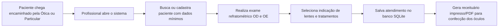
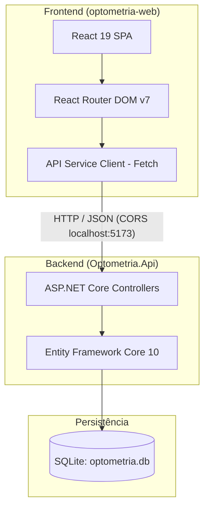
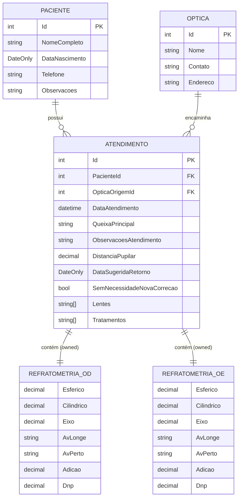

# Sistema de Gestão Optométrica — Visão Geral e Arquitetura Técnica

> **Status:** Documentação Técnica do MVP  
> **Versão:** 1.0  
> **Data:** 29/10/2026  
> **Público-alvo:** Desenvolvedores, mantenedores e stakeholders  

---

## 1. Visão do Produto e Proposta de Valor

### 1.1 O Que É o Sistema?
O **Sistema de Gestão Optométrica** é uma aplicação web *white label* projetada especificamente para consultórios e profissionais autônomos de optometria. O sistema digitaliza o ciclo de vida do atendimento visual: desde o cadastro simplificado do paciente até a realização do exame de refração ocular e a geração da prescrição ótica (receituário).

### 1.2 O Problema do Mundo Real
Tradicionalmente, consultórios de optometria parceiros de óticas operam com fichas e receituários de **papel manuscritos**. Isso acarreta:
1. **Ilegibilidade:** Dificuldade dos técnicos de laboratório e óticas em ler graus cilíndricos, eixos e adições, levando a erros na confecção de lentes.
2. **Perda de Histórico:** Ao retornar anos depois, o paciente frequentemente perdeu a receita anterior, e o profissional não tem busca rápida para comparar a evolução do erro refrativo.
3. **Fricção Operacional:** Redigitação desnecessária de dados e falta de padronização nos encaminhamentos de óticas parceiras.

### 1.3 A Proposta de Valor
- **Agilidade e Sem Fricção:** Preenchimento focado no profissional (sem bloqueios burocráticos ou campos obrigatórios excessivos).
- **Segurança Clínica e Legal:** Registro histórico imutável por consulta, separando claramente Olho Direito (OD) e Olho Esquerdo (OE).
- **Receituário Digital Profissional:** Emissão com 1 clique de prescrições padronizadas, prontas para impressão e envio à ótica.
- **Modelo White Label:** O núcleo da aplicação é neutro, permitindo que qualquer consultório/ótica adote o software customizando sua marca e identidade.

---

## 2. O Domínio da Optometria no Sistema

Para entender o código, é fundamental compreender a terminologia clínica modelada:

| Termo Clínico | Significado no Sistema | Campo no Modelo |
|---|---|---|
| **OD / OE** | Olho Direito (*Oculus Dexter*) e Olho Esquerdo (*Oculus Sinister*). | `OlhoDireito`, `OlhoEsquerdo` |
| **Esférico (SPH)** | Potência para correção de miopia (valores negativos) ou hipermetropia (valores positivos). | `Esferico` (decimal) |
| **Cilíndrico (CYL)** | Potência para correção de astigmatismo. | `Cilindrico` (decimal) |
| **Eixo (AXIS)** | Orientação do astigmatismo (em graus, de 0° a 180°). | `Eixo` (decimal) |
| **Adição (ADD)** | Potência adicional para visão de perto (presbiopia / "vista cansada"). Modelado separadamente por olho. | `Adicao` (decimal) |
| **AV Longe / Perto** | Acuidade visual (ex: 20/20, 20/40, J1, J2). | `AvLonge`, `AvPerto` (string) |
| **DNP** | Distância Nasopupilar monocular (centro do nariz até o centro da pupila de cada olho). | `Dnp` (decimal) |
| **DP** | Distância Pupilar binocular total. | `DistanciaPupilar` (decimal) |
| **Ótica de Origem** | Loja ótica parceira que encaminhou o paciente para a consulta. | `OpticaOrigemId` (chave estrangeira opcional) |

---

## 3. Arquitetura de Software

O projeto adota uma arquitetura em duas camadas desacopladas (SPA + REST API):

### 3.1 Stack Tecnológica

#### Backend (`Optometria.Api`)
- **Runtime & Framework:** .NET 10 (C# 13 / ASP.NET Core Web API).
- **ORM:** Entity Framework Core 10 (`Microsoft.EntityFrameworkCore.Sqlite`).
- **Banco de Dados:** SQLite (arquivo local `optometria.db`), ideal para consultórios locais e facilidade de backup/porte.
- **Documentação de API:** OpenAPI & Swagger UI (`Swashbuckle.AspNetCore`).
- **Segurança de Origem:** Política CORS habilitando `http://localhost:5173` (Vite dev server).

#### Frontend (`optometria-web`)
- **Biblioteca Base:** React 19 (`react`, `react-dom`).
- **Build Tooling:** Vite 8 (Hot Module Replacement ultrarrápido).
- **Roteamento:** React Router DOM v7.
- **Linter & Qualidade:** Oxlint (alta performance em Rust).
- **Comunicação HTTP:** Fetch API nativa modularizada em `src/services/api.js`.

---

## 4. Modelagem de Dados e Relacionamentos

### 4.1 Diagrama Entidade-Relacionamento (ERD)

### 4.2 Decisões Importantes de Modelagem
1. **Owned Entities (`OwnsOne`):** `RefratometriaOlho` não possui tabela própria nem chave primária independente. O EF Core armazena os campos de `OlhoDireito` e `OlhoEsquerdo` diretamente nas colunas da tabela `Atendimentos` (prefixadas ou embutidas), simplificando joins e mantendo a integridade atômica da consulta.
2. **Coleções Primitivas:** `Lentes` e `Tratamentos` são listas de strings serializadas nativamente na coluna `TEXT` do SQLite pelo EF Core 10, sem necessidade de tabelas associativas N:N desnecessárias no MVP.
3. **Exclusão Restrita:** A relação entre `Paciente` e `Atendimento` utiliza `OnDelete(DeleteBehavior.Restrict)`, impedindo a exclusão acidental de pacientes que possuam prontuários clínicos vinculados.

---

## 5. Catálogo de Endpoints da API REST

A API disponibiliza endpoints RESTful sob o prefixo `/api/`:

### Pacientes (`/api/pacientes`)
| Método | Rota | Descrição |
|---|---|---|
| `POST` | `/api/pacientes` | Cadastra um novo paciente. Retorna `201 Created` com o ID gerado. |
| `GET` | `/api/pacientes` | Lista pacientes. Suporta filtro por nome via query param `?nome=...`. |
| `GET` | `/api/pacientes/{id}` | Obtém os dados cadastrais de um paciente específico. |
| `PUT` | `/api/pacientes/{id}` | Atualiza dados cadastrais de um paciente. |
| `DELETE` | `/api/pacientes/{id}` | Remove um paciente (bloqueado se houver atendimentos). |

### Atendimentos (`/api/atendimentos`)
| Método | Rota | Descrição |
|---|---|---|
| `POST` | `/api/atendimentos` | Registra uma nova consulta clínica completa com refratometria de OD/OE. |
| `GET` | `/api/atendimentos/{id}` | Obtém a íntegra de um atendimento (incluindo dados do paciente e da ótica). |
| `GET` | `/api/atendimentos/paciente/{pacienteId}` | Obtém todo o histórico cronológico de consultas de um paciente. |

### Óticas (`/api/opticas`)
| Método | Rota | Descrição |
|---|---|---|
| `POST` | `/api/opticas` | Cadastra uma ótica parceira de encaminhamento. |
| `GET` | `/api/opticas` | Lista óticas cadastradas com filtro opcional por `?nome=...`. |
| `GET` | `/api/opticas/{id}` | Obtém detalhes de uma ótica por ID. |
| `PUT` | `/api/opticas/{id}` | Atualiza dados de contato/endereço da ótica. |
| `DELETE` | `/api/opticas/{id}` | Remove uma ótica. |

---

## 6. Práticas e Convenções Adotadas

1. **DTO Pattern (Data Transfer Objects):** As entidades de domínio (`Models`) nunca são expostas diretamente nos endpoints de entrada e saída. DTOs isolam o contrato da API do modelo do banco de dados.
2. **Tolerância a Campos Vazios (MVP Rule):** Nenhum campo de entrada do exame é obrigatório pelo sistema. Se a profissional não preencher a adição ou o eixo, o registro é salvo normalmente sem valores fictícios.
3. **CORS Padronizado:** A API já está liberada para comunicação direta com o frontend React em ambiente local.
